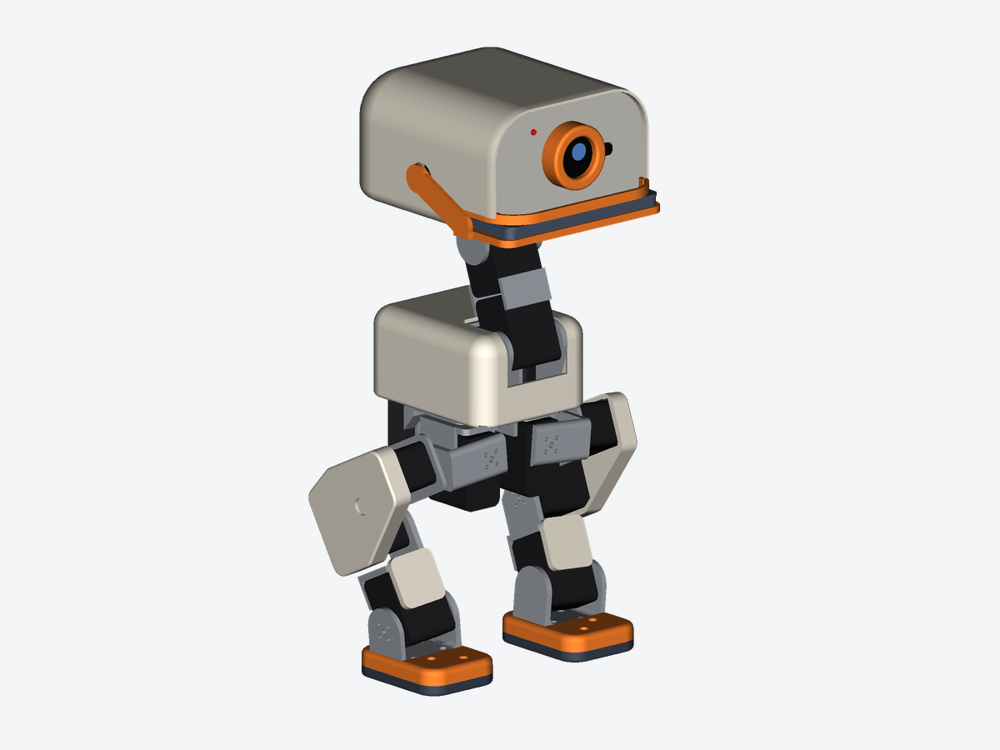
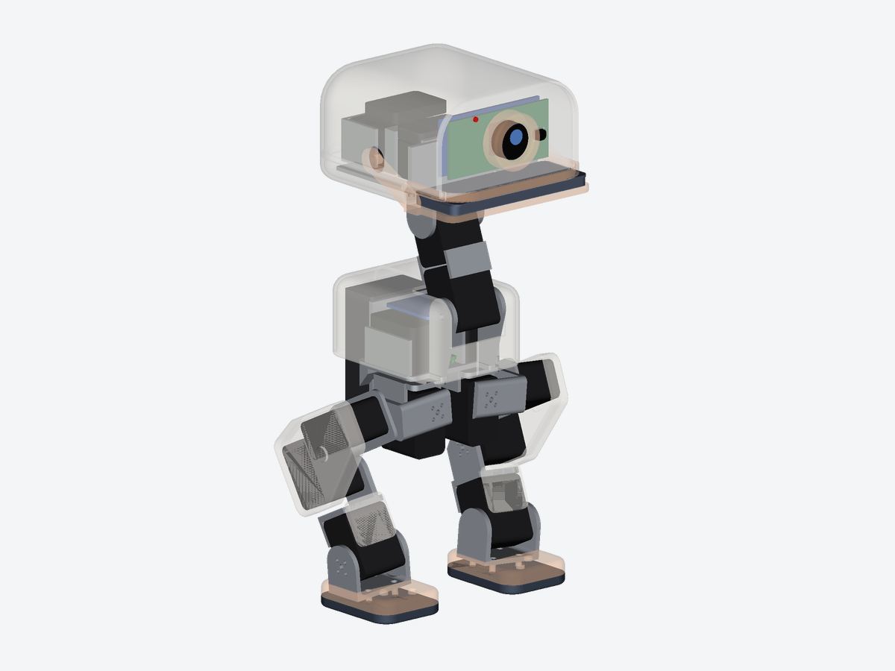
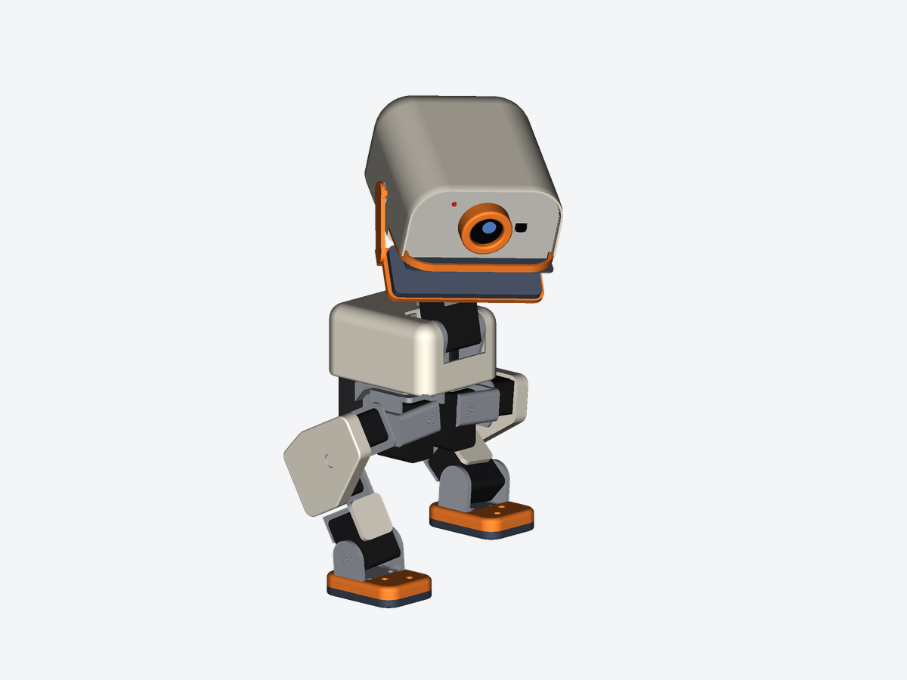
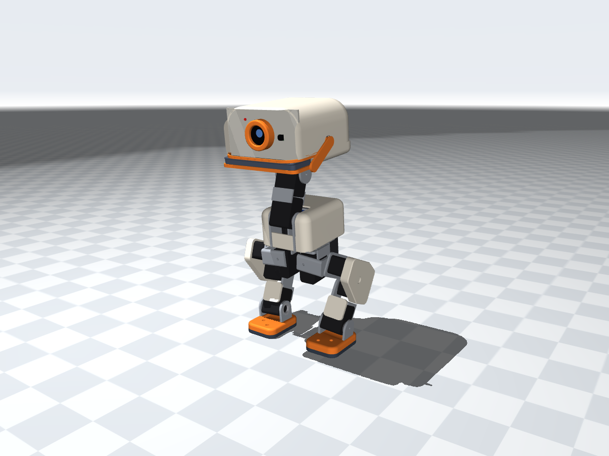
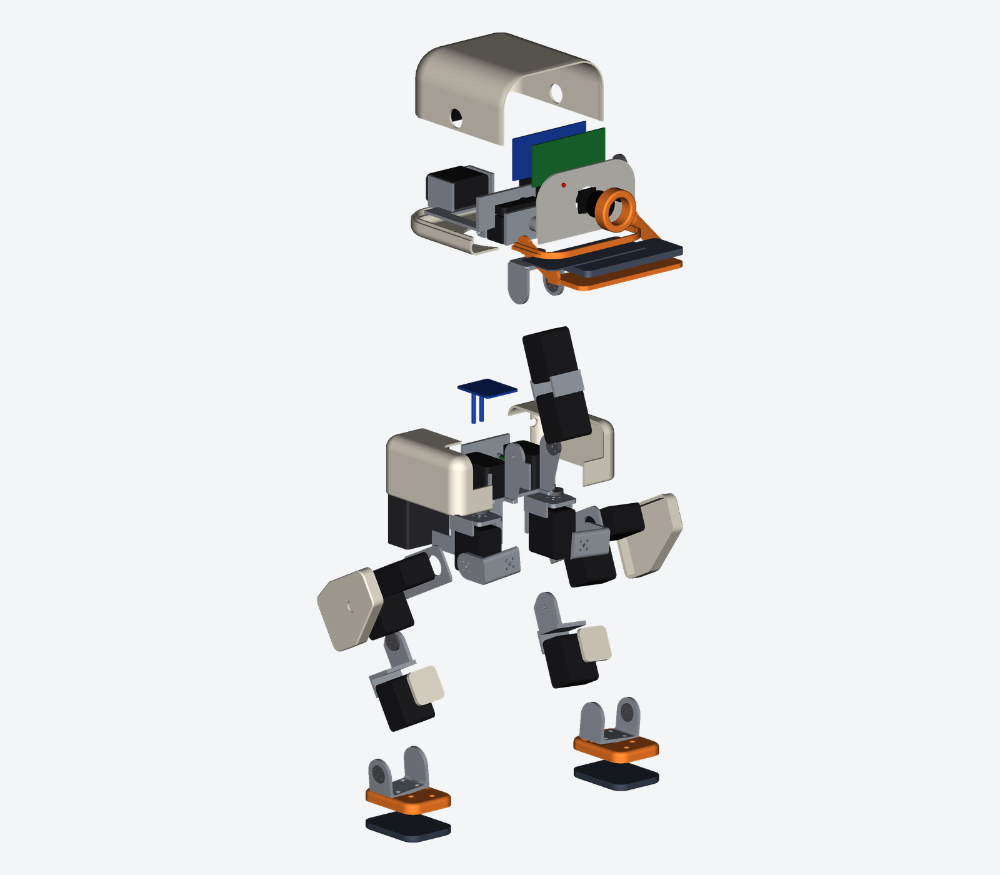
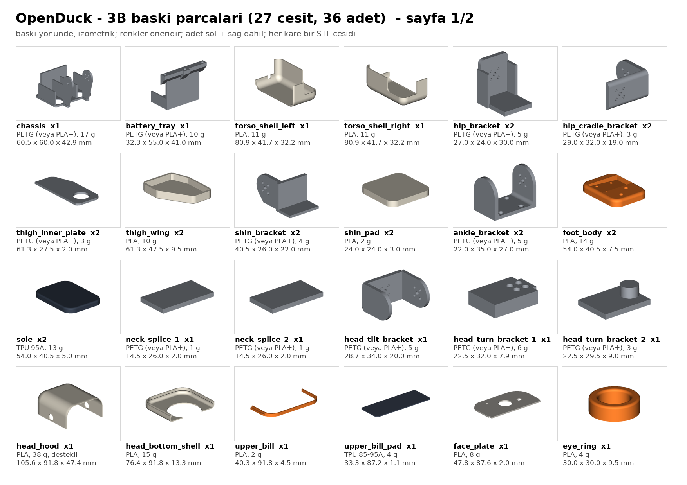

# OpenDuck-TR: Türkiye'de stokta olan parçalarla ördek robot

> **Durum: tasarım başlangıcı.** Bu repo, 27 cm'lik Microduck benzeri OpenDuck'ın
> ([Kubudak90/openduck](https://github.com/Kubudak90/openduck), `feat/sit-stand-getup` @ `1c8bc0c`)
> CAD, simülasyon ve RL hattından başlatıldı. Hedef: ~35 cm, Türkiye'de stokta olan ucuz servolar
> (8× DSSERVO DS3230MG bacaklarda, ES3054 / MG90S / SG90 hafif eklemlerde) ve ESP32-S3 ile çalışan
> bir sürüm. Tasarım kararları `docs/workflow/openduck-tr/` altında. Aşağıdaki içerik henüz
> XL330'lu micro robotu anlatıyor ve tasarım ilerledikçe güncellenecek.

---

# OpenDuck: FreeCAD'de Microduck benzeri ördek robot



**OpenDuck**, Pollen Robotics / Hugging Face'in **Microduck**'ına benzeyen, yaklaşık 27 cm boyunda,
15 servolu, çift ayaklı küçük bir ördek robottur. Microduck Ağustos 2026'da 399 $'a çıktı ve
21 Ekim 2026'da GTC Berlin'de Jensen Huang'la sahneye çıktı. Bu repo üç şey içeriyor:

1. **Tamamen parametrik bir FreeCAD (Python) modeli.** CAD, baskı STL'leri, STEP, URDF/MuJoCo
   modeli, malzeme listesi ve görseller tek komutla üretiliyor.
2. **Pekiştirmeli öğrenme (RL) ile yürüme eğitimi.** CPU'da MuJoCo + PyTorch PPO, GPU'da
   MJX + Brax. İkisi de aynı görev tanımını kullanıyor.
3. **RunPod'da GPU ile eğitim için araçlar.**

| | |
|---|---|
| Boy (HOME pozu) | 273 mm |
| Kütle (tahmini, kablo ve vida hariç) | ~675 g (servolar 270 g, baskı parçaları ~290 g) |
| Motor | 15 × ROBOTIS DYNAMIXEL XL330-M288-T: bacaklar 2×5, boyun ve kafa 4, gaga 1 |
| Algılayıcılar | kamera (göz), 8×8 ToF "lidar", gövde IMU'su |
| Beyin | Radxa Zero 3W (RK3566) veya Raspberry Pi Zero 2 W + robot HAT |
| Enerji | NP-F550 2S Li-ion, servolara doğrudan (Pollen'deki gibi) |

| İçi (x-ray) | Hareket pozu (gaga açık) | MuJoCo |
|---|---|---|
|  |  |  |

## Microduck'tan ne aldık, neyi kendimiz yaptık?

- **Kinematik birebir aynı.** Eklem yerleri, eksen yönleri, eklem adları ve sırası, servo
  ID'leri (10–14, 20–24, 30–34) ve HOME pozu Pollen'in Apache-2.0 lisanslı MJCF'inden
  ([pollen-robotics/microduck_rl](https://github.com/pollen-robotics/microduck_rl)) alındı.
  Bu sayede aynı yazılım altyapısı ve gözlem/aksiyon arayüzü kullanılabilir.
- **Bütün geometri bizim.** Kabuklar, braketler, ayaklar, gaga ve kafa sıfırdan çizildi.
  Pollen'in STL'leri CC BY-NC-SA lisanslı olduğu için kullanılmadı. Renkler ve isimler de
  Microduck'tan farklı tutuldu.
- **Eklem sınırları daha dar.** Pollen'in mekanik sınırları (diz, bilek ve kafa pitch ±90°,
  kafa roll ±25°) bizim gövdemizde uçlarda çarpışıyor. Sınırlar, çarpışma taramasında
  temiz kalan aralıklara göre seçildi (aşağıdaki tablo).

## Hızlı başlangıç

**Sadece bakmak için:** `build/openduck.FCStd` dosyasını FreeCAD 1.0+ ile açın.

- **Robotu oynatmak için** `Poz (derece)` hesap tablosunun **B sütunundaki** açıları
  değiştirin ve Ctrl+R ile yeniden hesaplatın. Tüm parçalar bu hücrelere bağlı.
- `build/openduck.step`: renkli montaj.
- `build/openduck_drawings.pdf`: çizim kitabı. Patlatılmış görünüşler, malzeme listesi,
  montaj sırası (servo ID ve HOME hazırlığı dahil), parça kataloğu ve her baskı parçası için
  ölçülü A4 teknik resim (ISO E, 1. açı).
- `build/print/`: **baskıya hazır** STL'ler, tüm baskı parçaları için birer dosya. Her STL tek
  bir katı parça; baskı yönüne çevrilmiş ve tablaya (z=0) oturtulmuş, dilimleyicide
  döndürmeyin. Birden fazla ayrık katıdan oluşan model parçaları (ör. iki plakalı
  `neck_splice`) `_1`, `_2` diye ayrı dosyalara bölünür. Parça ve dosya sayıları, malzeme, ayar,
  yön gerekçesi ve destek önerileri `build/print/PRINT.md` dosyasında. Hepsi tek dosyada:
  `build/openduck_print_parts.zip`.
- `build/docs/`: patlatılmış görseller (`exploded_*.png`), yatay A4 parça kataloğu
  (`parts_catalog*.png`) ve teknik resim sayfaları (`sheet_*.png`).
- `build/stl/`: model parçaları montaj (link) çerçevesinde, her model öğesi tek dosya (sol ve
  sağ ayrı). Simülasyon ve CAD için; baskı için `build/print/` kullanın.
- `build/BOM.md`: satın alınacaklar listesi; baskı parçalarının malzemesi (PRINT.md ile aynı),
  basılacak parça sayısı, hacim ve kütleleri.

| Patlatılmış görünüş | Baskı parçaları |
|---|---|
|  |  |

**Ölçüleri değiştirmek için:** `cad/openduck.py` başındaki `PARAMS` sözlüğünü düzenleyin.
Kabuk ve kafa ölçüleri, ayak, et kalınlığı, servo ölçüleri ve eklem noktaları buradan
ayarlanıyor. Sonra şunlardan birini yapın:

- FreeCAD'de **Makro → Makrolar… → `cad/openduck.py` → Çalıştır**, ya da
- komut satırından her şeyi yeniden üretin:

```bash
tools/build.sh            # FCStd, STEP, STL, URDF, MJCF, BOM, görseller, çizimler, baskı seti -> build/
tools/build.sh --check    # + çarpışma kontrolü (birkaç dakika)
python sim/stand_test.py  # MuJoCo: ayakta durma, çömelme, kafa ve gaga
```

## Eklemler

Koordinatlar: X ileri, Y sol, Z yukarı. Sıfır pozda uyluk 58° geriye eğik, incik dik durur
(Pollen'in sıfır pozu). Sağ bacak sol bacağın aynası; bu yüzden sağdaki açıların işareti ters.

| Eklem | Eksen (sol) | Sınır (°) | HOME (°) | Servo ID (sol/sağ) |
|---|---|---|---|---|
| hip_yaw | −Z | −20…30 | 0 | 20 / 10 |
| hip_roll | +X | −20…20 | −5 | 21 / 11 |
| hip_pitch | +Y | −90…90 | −26.2 | 22 / 12 |
| knee (kuş dizi) | −Y | −90…70 | −0.3 | 23 / 13 |
| ankle | +Y | −80…80 | 26.0 | 24 / 14 |
| neck_pitch | −Y | −90…40 | 20 | 30 |
| head_pitch | +Y | −30…90 | 20 | 31 |
| head_yaw | +Z | −170…170 | 0 | 32 |
| head_roll | −X | −12…12 | 0 | 33 |
| mouth (gaga) | +Y | 0…30 | 0 | 34 |

Gaga, kafanın içindeki servonun miline doğrudan bağlı bir alt çene. Karşı tarafta bir pim
üzerinde dönüyor. Tabanlar ayak bileğine göre 5° eğik monte ediliyor, böylece HOME pozunda
(kalça roll 5°) yere düz basıyorlar. Eğim montajda; taban ve ayak STL'leri düz basılır.

## Doğrulama

- **Çarpışma** (`cad/check.py` → `build/interference.txt`). Her eklem, diğerleri HOME
  pozundayken kendi sınırı boyunca taranıyor. 107 pozun hiçbirinde hacimsel çarpışma yok.
  Rastgele birleşik pozlarda kafa ±170° dönükken gaga açılırsa ya da bacaklar uçlarda
  birleşirse temas olabiliyor. Bunlar politikanın kaçınması gereken pozlar.
- **MuJoCo** (`sim/stand_test.py`):
  - HOME pozunda ağırlık merkezi tam ayak bileğinin üstünde.
  - Robot ayakta duruyor; servolar en fazla %7 yükte.
  - 20° çömelmede diz servosu tork sınırının %17'sinde.
  - Kafa yaw ±60° ile dönüyor, gaga açılıp kapanıyor.
  - Kafa ve boyun kütlenin ~%40'ı. Boyun açık döngüde büyük oynatılırsa robot devriliyor;
    büyük kafa hareketlerini dengeleyen, yürüme/durma politikası. Eğitimde kafa hedefleri
    bu yüzden rastgele oynatılıyor.

## Yürüme eğitimi (RL)

Görev joystick ile hız takibi: ileri −0.15…+0.3 m/s, yana ±0.15 m/s, dönüş ±1 rad/s.
Tanımı tek yerde: `rl/config.py` (sabitler), `rl/task_math.py` (gözlem/ödül/düşme,
numpy veya jax ile çalışır) ve `rl/TASK.md` (arka uç sözleşmesi).

- Politika 50 Hz'de 49 boyutlu gözlemden 10 bacak servosunun hedefini üretiyor.
- Kafa servoları eğitim sırasında rastgele hedeflere gidiyor; böylece politika kafa
  hareket ederken de dengede kalmayı öğreniyor.
- Alan rastgeleleştirme açık: ayak sürtünmesi, kütle, ağırlık merkezi, servo kazancı,
  sönümleme, itmeler ve gözlem gürültüsü.

```bash
# CPU (bu repo; 4 çekirdekte ~8 bin adım/s)
python -m rl.train --out runs/walk --num-envs 512 --max-steps 8e7
python -m rl.play --policy runs/walk/policy.onnx --demo --video demo.mp4

# GPU (MJX + Brax; RunPod veya CUDA'lı bir makine)
python -m rl.train_mjx --out runs/walk_gpu --num-envs 8192 --num-timesteps 2e8
```

Her iki eğitici de aynı biçimde `policy.onnx` üretiyor: girdi `obs` [N,49], çıktı `action`
[N,10]; gözlem normalizasyonu modelin içinde. Yanında `policy_meta.json` dosyası var.

<!-- RL_RESULTS -->

### Boy ayarı, oturma/kalkma ve düşünce kalkma

Tasarım `docs/workflow/sit-stand-getup/spec.md`'de, görev tanımları `rl/tasks.py`'de. Üç görev var
(`--task`):

| Görev | Ne yapar | Gözlem → aksiyon | Model |
|---|---|---|---|
| `walk` | yukarıdaki yürüme (değişmedi) | 49 → 10 | olduğu gibi |
| `main` | yürüme + boy komutu (çömelme) + yere oturup kalkma, tek politika | 53 → 10 | diz ≤ 65°, boyun ≤ 36°, içe kalça dönmesi ≤ 8° |
| `getup` | sırt/yüz/yan düşmüş hâlden ayağa kalkma | 48 → 14 (bacaklar + kafa) | + bacak/boyun/gaga çarpışma kutuları |

- `main`'in komutu 5 boyutlu: `[vx, vy, wz, h, sit]`. Bacak hedefleri boya ve oturma derecesine bağlı bir
  referans pozun etrafında artık (residual). Kafa oturuşta betikle geriye alınıyor.
- `getup` bölümleri 8 s sürüyor ve düşme yüzünden sonlanmıyor. Başlangıç durumları `rl/pose_bank.py`'nin
  deterministik düşmüş, düşüş ortası ve oturuş bankalarından geliyor.
- İki politikayı `rl/play.py` içindeki süpervizör birbirine bağlıyor. Gövde 5 adım boyunca devrik kalırsa
  `getup`'a geçiyor; robot 0.5 s dik kalınca `main`'e dönüyor.

```bash
python -m rl.train_mjx --task main  --out runs/main  --num-timesteps 1e9
python -m rl.train_mjx --task getup --out runs/getup --num-timesteps 1e9

python -m rl.play --policy runs/main/policy.onnx --demo sit --video sit.mp4
python -m rl.play --policy runs/main/policy.onnx --getup-policy runs/getup/policy.onnx --demo getup --tip back
python -m rl.eval_tasks --main-policy runs/main/policy.onnx --walk-policy runs/walk-mjx-v2/policy.onnx \
    --getup-policy runs/getup/policy.onnx --collision --out runs/main/eval.json   # kabul ölçütleri A1–A4, A8
```

### RunPod

`tools/runpod/` bir RunPod GPU pod'u açıyor, eğitimi çalıştırıyor, sonuçları HTTPS üzerinden
indiriyor ve pod'u kapatıyor. Kullanım ve maliyet sınırları için `tools/runpod/README.md`'ye
bakın. API anahtarı ortam değişkeni olarak (`RUNPOD_API_KEY`) verilmeli; hiçbir dosyaya
yazılmıyor. Repo özel (private) olduğu için kod pod'a ya satır içi paketle ya da RunPod
secret'ındaki bir GitHub token'ıyla gidiyor.

## Dosyalar

```
cad/openduck.py     parametreler + geometri + kinematik + FreeCAD belgesi (makro olarak da çalışır)
cad/export.py       STEP / STL / URDF / MJCF / BOM / görsel üretimi
cad/check.py        çarpışma kontrolü
cad/docs.py         baskı seti (yönlendirilmiş STL'ler), patlatılmış görseller, teknik resimler, PDF
tools/build.sh      tek komutla tam derleme
sim/stand_test.py   MuJoCo duman testi
rl/                 RL: config, tasks, task_math, pose_bank, env_cpu, ppo, train, play, eval_tasks, env_mjx, train_mjx, testler
sim/collision_check.py  görsel mesh öz-çarpışma denetimi (spec A8)
tools/runpod/       RunPod başlatıcı ve pod betiği
build/              üretilmiş çıktılar (FCStd, STEP, stl/, print/, docs/, sim/, img/, PDF, BOM.md, summary.json)
```

## Bilinen sınırlamalar

- Vida delikleri, kablo kanalları ve baskı toleransları sadeleştirildi. Basmadan önce gerçek
  XL330 braket delik düzenine göre kontrol edin. Mil ofseti 9.5/24.5 mm, gövde
  20×34×26 mm alındı.
- Kütleler tahmini. Gerçek Microduck 740–780 g, bizim model ~675 g (kablo ve vida hariç).
- Servolar, Pollen'deki gibi 2S bataryayla (6.6–8.2 V) doğrudan besleniyor. Bu, ROBOTIS'in
  6 V sınırının üstünde. Daha temkinli seçenek 6 V regülatör, ama o zaman motor modelini
  yeniden ölçmek gerekir.
- Simülasyonda servo modeli basit: kp 1.1 N·m/rad, tork sınırı 0.96 N·m, Pollen/BAM'den
  alınan sönümleme ve sürtünme. Gerçek robota aktarmadan önce Rhoban BAM ile motor tanımlama
  önerilir.
- Bu repodaki ilk tasarım daha büyük, Open Duck Mini v2 benzeri bir robottu (47 cm,
  14 × STS3215). O sürüm artık kendi reposunda:
  [Kubudak90/openduck-mini](https://github.com/Kubudak90/openduck-mini).
  Bu repodaki geçmişte de `e206878` commit'inde duruyor.
